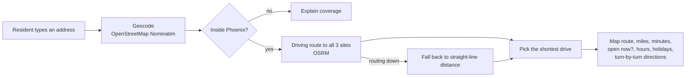
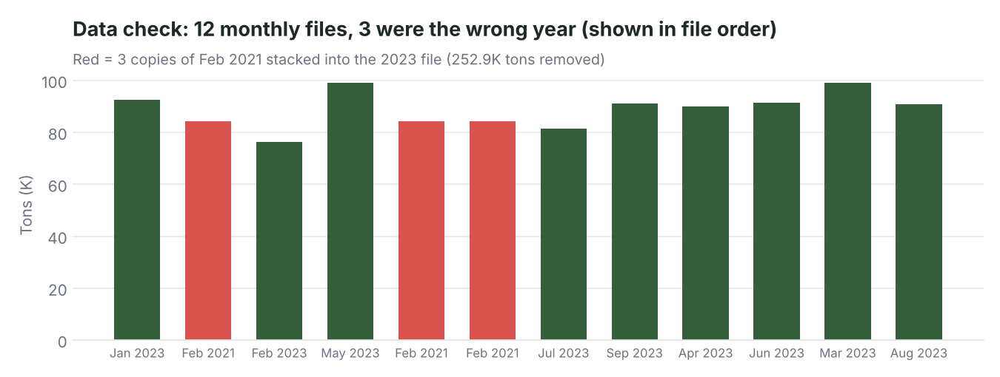
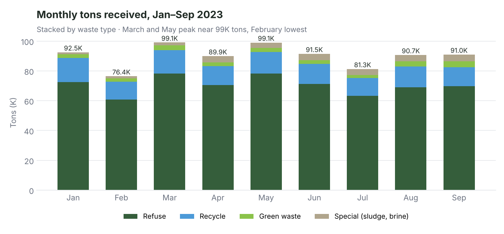
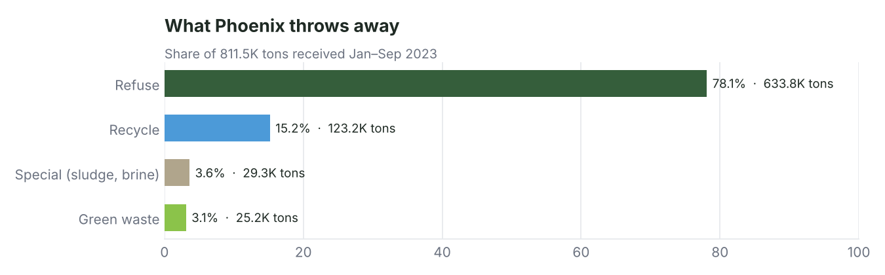

# Greenway: Phoenix Waste Drop-Off Finder & Waste Analytics

[](https://github.com/vrutikadani/Greenway-Phoenix-Sustainability/actions/workflows/ci.yml)

Greenway helps Phoenix residents find the closest city landfill or transfer station, with the driving route, drive time, opening hours and holiday closures. It also includes an analysis of 2023 city waste tonnage and a Tableau dashboard for city planners.

> **Context.** Built as a 4-person applied project for IFT 593 at Arizona State University (Spring 2024). In 2026 I came back to it: rebuilt the web app so it runs with no API keys, made the analysis reproducible, and found a data problem in the original dataset that inflated the totals by 31%.

**Live demo:** [vrutikadani.github.io/Greenway-Phoenix-Sustainability/web](https://vrutikadani.github.io/Greenway-Phoenix-Sustainability/web/) · **Tableau dashboard:** [Sustainable Waste Management: Phoenix City Insights](https://public.tableau.com/app/profile/vrutik.sanjay.adani/viz/SustainableWasteManagement-PhoenixCityInsights_171289461)

## The problem

Phoenix runs three public drop-off sites, but residents have to work out which one is closest, whether it's open today, and how to get there. City planners also need a clear view of how much waste comes in, what type, and when.

## 1. The drop-off finder



| What you get | How |
|---|---|
| Closest site by **driving** distance, not straight line | Routes to every site, picks the shortest |
| Drive time and turn-by-turn directions | OSRM route steps |
| **Open now / closed** status | Site hours checked in Arizona time (UTC-7, no daylight saving) |
| Holiday closures, bulk trash link, Google Maps hand-off | Static city data |
| Optional address check + service area | Drop the city's service-address CSV into `web/data/` |

**Run it:** open `web/index.html` through any static server, for example `python -m http.server -d web 8080`, then go to `localhost:8080`. No keys needed.

### What I fixed in the 2026 rebuild

| Original (2024) | Now |
|---|---|
| Data loaded from `127.0.0.1:8080` and icons from one teammate's laptop (`file:///Users/...`) | Relative paths and inline icons, so it runs anywhere and can be hosted on GitHub Pages |
| Needed a paid Mapbox token in the code | Free OpenStreetMap + OSRM, no keys in the repo |
| CSV split on every comma, which broke on addresses like `"200 W Washington St, Phoenix"` | Proper CSV parsing with quoted fields |
| Address had to match the city file exactly, letter for letter | Normalized matching (`Street` = `St`, `West` = `W`) |
| A routing error left the user with nothing | Falls back to straight-line distance |
| No tests | 6 unit tests on the distance, CSV, address and open-hours logic |

## 2. Waste analysis (2023)

`analysis/waste_analysis.py` reads the tonnage file, checks it, and writes the charts below.

### Data check: a 31% overcount

The 2023 file was built by stacking 12 monthly extracts from Phoenix Open Data. When I checked each extract's dates, **3 of the 12 were the same February 2021 file**, not October–December 2023. Together they added 88.8K rows and **252.9K tons** that don't belong in 2023.



| | Original report | Corrected |
|---|---|---|
| Period | "2023" | Jan–Sep 2023 (9 months) |
| Total tons | 1,064.4K | **811.5K** |
| Refuse share | 80.8% | 78.1% |

The script spots this on its own: every monthly extract restarts its `_id` at 1, so it splits the file there and keeps only extracts dated inside 2023.

### Findings (corrected data)





- **811.5K tons** came into city sites in Jan–Sep 2023, about **90K tons a month**.
- **Refuse is 78%** of everything. Recycling is 15%, green waste 3%.
- **March and May peak** near 99K tons, and **February is lowest** at 76K. Part of that dip is just a shorter month.
- **27th Ave handles 58%** of all tons (467.9K), North Gateway 39% (314.2K), and the SR-85 landfill 4%.

**So what for the city:** recycling captures only about 1 ton in 6. Diverting even 5 points of refuse to recycling would keep roughly 50K tons a year out of the landfill. 27th Ave carries most of the load, so it's where peak-month staffing and capacity planning matter most.

```bash
pip install -r requirements.txt
python analysis/waste_analysis.py      # prints the summary, writes images/
node --test tests/geo.test.js          # web app logic tests
```

## Repo map

| Path | What it is |
|---|---|
| `web/` | The drop-off finder (`index.html`, `app.js`, `geo.js`, `stations.js`) |
| `analysis/waste_analysis.py` | Data check + charts |
| `images/` | Charts used in this README |
| `df23.csv` | Tonnage data from Phoenix Open Data (as originally collected) |
| `Data_Cleaning.ipynb`, `Greenway - Phoenix Sustainability.ipynb` | Original 2024 cleaning and exploration notebooks |
| `Greenway - Phoenix Sustainability.pdf` | Original project report |
| `tests/` | Unit tests |

## Data sources

- [Phoenix Open Data](https://www.phoenixopendata.com/): solid waste active service addresses, landfill and transfer station tonnage, city limit boundary
- City of Phoenix Public Works: site hours and holidays (2024)

## Team (2024)

Megha Jotangiya · Vrutik Adani · Harshita Mishra · Bhavya Atul Shah. Arizona State University, IFT 593 Applied Project, advised by Dr. Asmaa Elbadrawy.

---

